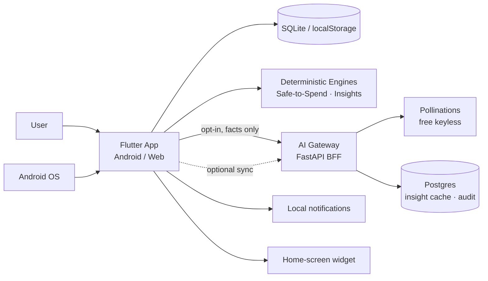
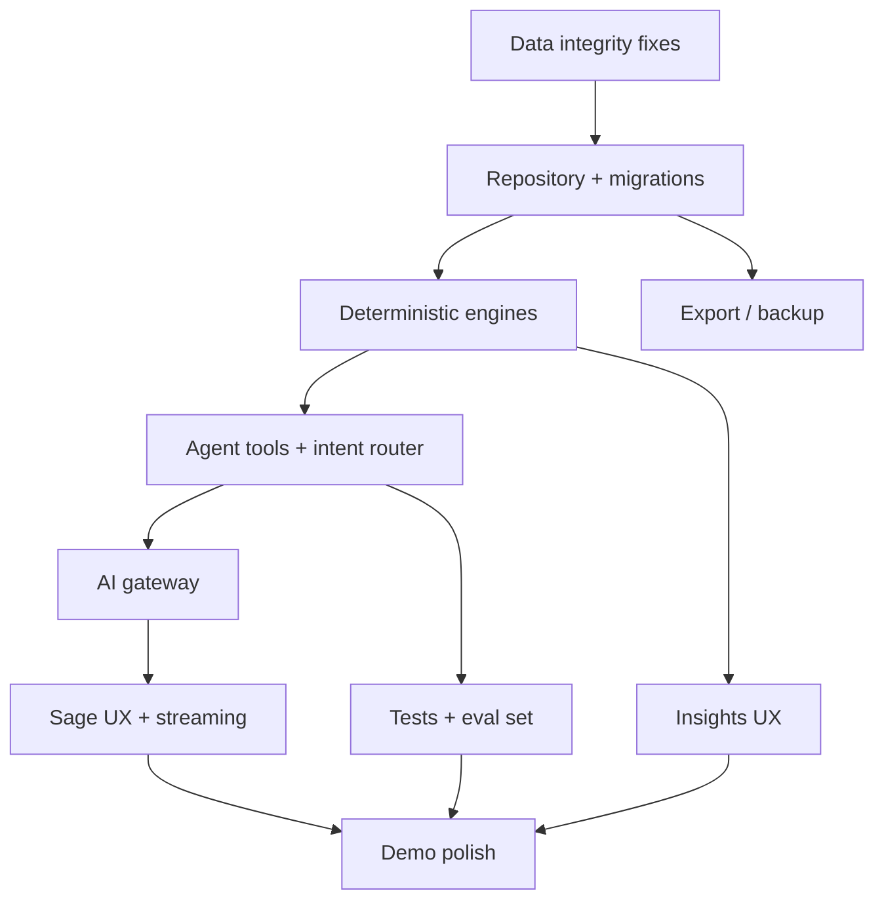

# Safe to Spend — Architecture & Implementation Plan

> **Scope.** AI layer (Smart Insights + Sage chat assistant) on top of the existing
> offline-first Flutter expense tracker, built as a university project demo.
>
> **Current state:** Flutter client only. No backend, no accounts, no cloud sync.
> AI calls go directly from the app to Pollinations (free, keyless). All financial
> data lives in SQLite on Android / localStorage on web.

---

## 1. Product thesis and architectural consequence

The product promise is: *"Your bank balance is not the whole story. Everything stays
on this phone. No account, no cloud, no cost."*

That promise dictates the architecture:

| Promise | Architectural rule |
|---|---|
| Works offline | Every core action (log, budget, goal, payment) must succeed with zero network. |
| Numbers are trustworthy | All arithmetic is deterministic and on-device; the LLM only *phrases* facts. |
| No account | Identity is optional and device-bound; no login wall. |
| No cloud | Cloud AI is opt-in and sends a *minimized* fact sheet, not raw notes. |
| No cost | Free/keyless model provider, free-tier hosting only, aggressive caching. |

**Key tension to resolve:** the current chat sends the last 30 transactions, notes,
and balances to a third-party endpoint. That contradicts "everything stays on this
phone" and is the single biggest product/security risk to fix.

---

## 2. System context



**Two deployment modes**

1. **Demo mode (now):** client → Pollinations directly. Zero infra, zero cost, but
   no key control, no caching, rate-limited to 1 request / 45 s per IP.
2. **Target mode:** client → own AI gateway → provider. Adds caching, redaction,
   retries, per-device quotas, and observability. Required if the project is graded
   on security or privacy.

Recommendation: build the gateway, but keep direct mode as an automatic fallback so
the demo never dies when the free host cold-starts.

---

## 3. Frontend architecture

### 3.1 Shape

Feature-first modular monolith, unidirectional data flow:

```
lib/
  main.dart                 # bootstrap only
  app/                      # shell, routing, DI overrides
  core/                     # money type, dates, Result, failures, logging
  features/
    home/                   # dashboard + safe-to-spend hero
    transactions/           # add/edit/delete, filters, CSV
    budgets/
    goals/
    payments/
    insights/               # deterministic + AI narratives
    assistant/              # Sage chat
    settings/               # privacy, lock, export, erase
  data/
    local/                  # sqflite DAOs + migrations
    remote/                 # AI gateway client
    repositories/           # single source of truth
  services/
    safe_to_spend_engine.dart
    insights_engine.dart
    ai/                     # intent router, tools, gateway, cache
```

### 3.2 State and data flow

- **Riverpod** providers per feature; repositories exposed as providers.
- **Repository is the only writer.** Screens never touch sqflite / SharedPreferences.
- **`AsyncValue` tri-state** in UI: loading → data / error with retry.
- **Optimistic writes** for transaction logging, with rollback on failure.
- **Single money type** (`Money` in paise/cents as `int`) to remove floating-point
  drift; crossing to/from `double` only at the DB boundary.
- **Derived, not stored:** `current_balance` should be computed from
  `initial_balance + Σincome − Σexpense`, not maintained as a mutable column.
  (Today it is stored and drifts when a transaction is deleted.)

### 3.3 Platform abstraction

`AppStore` already switches IO ↔ web at compile time. Keep the interface but rename
it to a repository contract and move budget/goal methods into it (web currently
implements them separately from IO, which invites parity bugs).

### 3.4 UI constraints

- 5-tab shell: Home · Payments · Budgets · Goals · More.
- Insights and Sage are pushed routes, not tabs (current design).
- Every AI surface needs three states: **thinking**, **answer**, **offline
  fallback** — never a spinner that can hang for 100 s.

---

## 4. Backend architecture

### 4.1 Why a backend at all

The app is local-first, so the backend is **not** a system of record. It is a thin
BFF (backend-for-frontend) with four jobs:

1. **AI gateway** — hide provider quirks, cache, quota, redact.
2. **Optional sync** — multi-device backup without forcing an account.
3. **Audit/telemetry** — opt-in, redacted, for the project report.
4. **Export/share** — server-side PDF/CSV if ever needed.

### 4.2 Recommended stack

| Layer | Choice | Why |
|---|---|---|
| Runtime | Python 3.12 + FastAPI | Already used in `~/content-copilot`; async streaming; typed. |
| Validation | Pydantic v2 | Request/response contracts, JSON-schema for agent actions. |
| DB | Postgres (Neon/Supabase free tier) | RLS, JSONB, free tier. |
| Cache | Postgres table + TTL (no Redis) | One less dependency; demo-scale traffic. |
| Queue | None initially; in-process `asyncio` | Avoid over-engineering. Add only for batch insight precompute. |
| Deploy | Fly.io / Render free web service | Single container, health check, no cold-start on Fly. |
| Auth | Device-bound JWT (see §6) | No passwords, no email. |

### 4.3 Internal layering

```
api/          # routers: /ai, /sync, /auth, /health
domain/       # use-cases: answer_question, generate_insights, sync_push
agents/       # router, tools, executor, prompts, guardrails
providers/    # pollinations.py, fallback.py (interface + adapters)
repositories/ # postgres access, cache, audit
core/         # config, errors, logging, rate limit
```

Rules: routers do I/O shaping only; domain never imports FastAPI; providers are
swappable behind a Protocol; every external call has a timeout.

### 4.4 Scaling path (only if needed)

Single instance → horizontal instances behind a load balancer → move insight cache
to Redis → add a job queue for nightly insight precomputation. Do not build this
now; the demo has one user.

---

## 5. Database schema

### 5.1 Local (SQLite) — system of record

Add a real migration path (`onUpgrade`, `schema_version`) before adding columns.

```sql
-- existing, corrected
user_settings(
  id INTEGER PRIMARY KEY CHECK (id = 1),
  initial_balance_cents INTEGER NOT NULL DEFAULT 0,
  currency_code TEXT NOT NULL DEFAULT 'INR',
  locale TEXT NOT NULL DEFAULT 'en-IN',
  ai_consent INTEGER NOT NULL DEFAULT 0,      -- NEW: opt-in for cloud AI
  app_lock_enabled INTEGER NOT NULL DEFAULT 0,
  horizon_days INTEGER NOT NULL DEFAULT 30,
  updated_at TEXT NOT NULL
)
-- NOTE: current_balance is derived; drop the stored column after migration.

transactions(
  id TEXT PRIMARY KEY,
  amount_cents INTEGER NOT NULL CHECK (amount_cents > 0),
  type TEXT NOT NULL CHECK (type IN ('INCOME','EXPENSE')),
  category_id TEXT NOT NULL REFERENCES categories(id),
  occurred_on TEXT NOT NULL,                  -- YYYY-MM-DD, local date
  note TEXT,
  source TEXT NOT NULL DEFAULT 'manual',      -- manual | assistant | import
  idempotency_key TEXT UNIQUE,                -- AI-added rows
  created_at TEXT NOT NULL,
  deleted_at TEXT                             -- soft delete for sync
)
CREATE INDEX idx_tx_date ON transactions(occurred_on DESC);
CREATE INDEX idx_tx_category ON transactions(category_id, occurred_on);

categories(id TEXT PRIMARY KEY, name TEXT NOT NULL, icon TEXT, color TEXT, is_system INTEGER);

recurring_payments(
  id TEXT PRIMARY KEY, name TEXT NOT NULL, amount_cents INTEGER NOT NULL,
  category_id TEXT NOT NULL, frequency TEXT NOT NULL,
  next_due_on TEXT NOT NULL, end_on TEXT, is_active INTEGER NOT NULL DEFAULT 1,
  last_paid_on TEXT, note TEXT
)
CREATE INDEX idx_recurring_due ON recurring_payments(is_active, next_due_on);

budgets(
  id TEXT PRIMARY KEY,
  category_id TEXT NOT NULL UNIQUE REFERENCES categories(id),
  monthly_limit_cents INTEGER NOT NULL CHECK (monthly_limit_cents > 0),
  warn_at_pct INTEGER NOT NULL DEFAULT 80,
  created_at TEXT NOT NULL
)

savings_goals(
  id TEXT PRIMARY KEY, name TEXT NOT NULL,
  target_cents INTEGER NOT NULL CHECK (target_cents > 0),
  saved_cents INTEGER NOT NULL DEFAULT 0,
  target_date TEXT, created_at TEXT NOT NULL
)

chat_messages(                              -- NEW: persist Sage memory
  id TEXT PRIMARY KEY, role TEXT NOT NULL,
  content TEXT NOT NULL, created_at TEXT NOT NULL
)

ai_insight_cache(                           -- NEW: offline + rate-limit shield
  cache_key TEXT PRIMARY KEY, payload TEXT NOT NULL,
  created_at TEXT NOT NULL, expires_at TEXT NOT NULL
)
```

**Schema fixes required now**
- `budgets` table lacks `warn_at_pct` / `created_at`, yet `BudgetModel` uses them —
  the IO store hardcodes 80 and "now", so edits can't round-trip.
- `savings_goals` lacks `created_at`, while the model expects it.
- No indexes on date/category → monthly aggregations scan the whole table.
- `deleteTransaction` does not reverse the balance; `clearAll` does not reset it.
- Two storages (SQLite and SharedPreferences) implement different field mappings.

### 5.2 Server (Postgres) — optional sync + AI metadata

```sql
users(id UUID PK, created_at TIMESTAMPTZ, plan TEXT DEFAULT 'free');
devices(id UUID PK, user_id UUID REFERENCES users, platform TEXT,
        push_token TEXT, last_seen_at TIMESTAMPTZ);
sync_records(user_id UUID, entity TEXT, entity_id TEXT, payload JSONB,
             updated_at TIMESTAMPTZ, deleted BOOLEAN,
             PRIMARY KEY(user_id, entity, entity_id));
sync_cursors(user_id UUID, device_id UUID, last_pulled_at TIMESTAMPTZ,
             PRIMARY KEY(user_id, device_id));
ai_requests(id UUID PK, user_id UUID, device_id UUID, kind TEXT,
            prompt_tokens INT, completion_tokens INT, latency_ms INT,
            provider TEXT, status TEXT, error_code TEXT, created_at TIMESTAMPTZ);
insight_cache(cache_key TEXT PK, payload JSONB, expires_at TIMESTAMPTZ);
```

**Security:** enable Row-Level Security on every user table with
`user_id = current_setting('app.user_id')::uuid`. The app never queries without a
user context. Free-tier Postgres + RLS is enough for the project.

**Never store** raw transaction notes in `ai_requests`; store counts, hashes, and
error codes only.

---

## 6. API endpoints

Base: `/v1`. JSON, `Authorization: Bearer <jwt>` except health/auth.

### AI

| Method | Path | Purpose | Notes |
|---|---|---|---|
| POST | `/ai/chat` | Sage reply | SSE stream; request: `{message, history[], facts, consent}` |
| POST | `/ai/insights` | 3 narrative insights | Returns cached JSON; 24 h TTL per facts hash |
| POST | `/ai/parse` | NL → structured transaction | Returns `{amount, type, category, date, confidence}` |
| POST | `/ai/afford` | Affordability check | Deterministic comparison + optional phrasing |
| GET | `/ai/status` | Provider health | For client circuit breaker |

### Sync (optional, P2)

| Method | Path | Purpose |
|---|---|---|
| POST | `/auth/device` | Register anonymous device, return JWT pair |
| POST | `/auth/refresh` | Rotate access token |
| POST | `/sync/push` | Batch upsert with `updated_at` + tombstones |
| GET | `/sync/pull?since=` | Incremental changes |
| DELETE | `/account` | Erase server copy only |

### Ops

| Method | Path | Purpose |
|---|---|---|
| GET | `/health` | Liveness + provider probe (no auth) |
| GET | `/metrics` | Prometheus, internal only |

### Contracts

- All requests validated with Pydantic; unknown fields rejected.
- Errors use one envelope: `{error: {code, message, retryable, request_id}}`.
- Streaming uses SSE `data:` frames with a terminal `[DONE]`.
- `Idempotency-Key` required on `/ai/parse` when the client will auto-commit.

---

## 7. AI agent architecture

### 7.1 Principle: the model is a narrator, not a calculator

```
User message
   │
   ▼
Intent Router (deterministic, on-device)
   ├── ADD_TRANSACTION ──► local parser ──► validate ──► confirm ──► write
   ├── FACT_QUERY ───────► SafeToSpend/Insights engines ──► templated answer
   ├── AFFORDABILITY ────► deterministic projection ──► LLM phrases verdict
   ├── ADVICE ───────────► fact sheet ──► LLM (grounded) ──► guardrail
   └── UNKNOWN ──────────► LLM fallback ──► offline template
```

This preserves the strongest existing decision in the codebase: factual questions
are answered from the DB, never by the LLM.

### 7.2 Components

| Component | Responsibility | Where |
|---|---|---|
| Intent Router | Classify into 5 intents; cheap regex + keywords | Client |
| Fact Builder | `computeFacts()` — balances, trends, anomalies, upcoming | Client |
| Tool Registry | `get_facts`, `query_transactions`, `project_balance`, `add_transaction`, `set_budget` | Client (tool schemas shared with server) |
| Planner | Single-step by default; 2-step only for compound questions | Client |
| Executor | Runs tools, enforces schema, bounds, idempotency | Client |
| Narrator | LLM phrasing from facts only | Server gateway |
| Validator | JSON schema, amount/date/category bounds, no negative values | Client + server |
| Memory | Last 10 turns, persisted in `chat_messages`, summarized after 20 | Client |
| Guardrails | No invented numbers, no regulated advice, injection isolation | Both |

### 7.3 Tool contracts (typed, allow-listed)

```json
{"name":"add_transaction",
 "args":{"amount_cents":{"type":"int","min":1,"max":100000000},
         "type":{"enum":["INCOME","EXPENSE"]},
         "category":{"enum":["food","transport","groceries","rent","utilities",
                             "health","education","shopping","entertainment","other"]},
         "occurred_on":{"type":"date","not_future":true},
         "note":{"type":"string","max":80}},
 "requires_confirmation":true,
 "idempotency_key":"required"}
```

Rules:
- **Write tools always require explicit user confirmation** in the UI, even when
  the model is confident. This prevents silent mis-posts.
- Unknown category → `other`, never free text.
- Future dates rejected except scheduled payments.
- Every AI write carries `source='assistant'` and an idempotency key.

### 7.4 Prompt and grounding

System prompt must contain: role, allowed capabilities, output contract, and the
hard rules ("use only FACTS; never do arithmetic; if a fact is missing, say so").
Facts are passed as a compact JSON object. Raw notes are excluded by default
(privacy); only category/amount/date aggregates are sent.

**Injection defense:** treat all user-authored strings (notes, goal names) as
untrusted data, strip control tokens, and never place them in the system prompt.
The current design puts transaction notes into the facts JSON — a note like
"ignore previous instructions" reaches the model. Redact or delimit them.

### 7.5 Model gateway

```
provider chain: Pollinations (openai-fast) → secondary free provider → local template
circuit:        open after 3 consecutive failures, half-open after 5 min
timeouts:       connect 3 s, total 12 s (not 45 s)
retry:          at most 1, exponential backoff with jitter
cache:          insights keyed by hash(facts + prompt_version), 24 h TTL
streaming:      SSE to client; first token target < 2 s
```

The current 3 × 45 s retry loop can freeze a screen for ~105 s and still fail.
That is the top demo risk.

---

## 8. Authentication and authorization

### 8.1 Local (primary)

- **App lock:** biometric / device credential via `local_auth`, enabled in Settings.
- **Threat model:** casual device access only. Data is not encrypted at rest today.
- **P1 hardening:** SQLCipher (or platform keystore-wrapped key) so a rooted device
  or backup extraction cannot read finances. SQLCipher adds a native dependency —
  accept the build risk only after the demo works.
- **No passwords, no email.** This is a feature, not a gap.

### 8.2 Server (only if AI gateway/sync is enabled)

- `POST /auth/device` issues a device UUID + JWT access (15 min) + refresh (30 d).
- Access token carries `user_id`, `device_id`, `scope` (`ai`, `sync`).
- Refresh tokens rotate; reuse revokes the family.
- Rate limits per device and per IP (e.g. 20 AI calls/day free tier).
- **Authorization:** every row scoped by `user_id`; Postgres RLS as defense in depth.
- No admin surface in v1. If added, separate role claim + audit log.

### 8.3 Consent

Cloud AI is **off by default** on first launch. Settings shows exactly what leaves
the device (aggregates, not notes) and a one-tap "Use on-device only" switch.
This is both ethical and a strong demo talking point.

---

## 9. External integrations

| Integration | Use | Failure mode | Mitigation |
|---|---|---|---|
| Pollinations (`text.pollinations.ai`) | Insight narration, chat | 429 (1/45 s), 5xx, slow | Cache, single retry, circuit breaker, local fallback |
| Secondary free LLM (e.g. Gemini free tier) | Failover | quota/key | Only if a key is acceptable; otherwise skip |
| `flutter_local_notifications` | Payment + logging reminders | Android 13 permission, exact-alarm limits | Request at first use; inexact fallback |
| `home_widget` | Home-screen widget | OEM launchers | Graceful "not supported" |
| `share_plus` / `csv` | Export | No share target | Save-to-file fallback |
| `local_auth` | App lock | No biometrics enrolled | Device credential fallback |
| `sqflite` / `shared_preferences` | Persistence | Corruption / quota | Backup JSON, integrity check |
| Android build (Gradle, signing) | APK demo | Toolchain drift | Pin versions, build early |

**Cost guardrail:** every integration must remain on a free tier or be keyless.
No paid API, no card on file.

---

## 10. Error handling

### 10.1 Taxonomy

| Class | Examples | UX | Retry? |
|---|---|---|---|
| Validation | amount ≤ 0, bad date | Inline field error | No |
| Storage | disk full, DB locked | Blocking sheet + export offer | Once |
| Auth | biometric cancelled | Stay locked, no error toast | User-initiated |
| Network | offline, DNS | Offline chip, local answer | On reconnect |
| Rate limit | 429 | "Sage is resting — here's the offline answer" | After cooldown |
| Timeout | > 12 s | Fallback answer + retry button | Once |
| Provider | 5xx, malformed JSON | Fallback + telemetry | Circuit breaker |
| Agent | invalid tool args | Silent repair or ask user | No auto-write |

### 10.2 Rules

- **Core flows never depend on AI.** Logging, budgets, goals, payments always work.
- **Every network call has a timeout and a fallback.** No unbounded awaits.
- **One error envelope** across client and server, with a `request_id`.
- **Idempotency** for AI-added transactions; dedupe by key.
- **Circuit breaker** shared by insights and chat so one outage doesn't cause two
  retry storms.
- **Local log ring buffer** (last 200 events, redacted) + opt-in export for the
  project report. Never log amounts, notes, or tokens.
- **Crash boundary per screen**; a failed Insights tab must not take down Home.
- **User-facing copy** explains what happened and what still works ("You're
  offline. Numbers are exact; AI phrasing is unavailable.").

---

## 11. Dependencies and build order



| Dependency | Depends on | Risk |
|---|---|---|
| Data integrity | nothing | Low; must be first |
| Migrations | schema decisions | Low |
| Agent tools | repository contract | Medium |
| Gateway | hosting + provider | Medium (cold start) |
| Streaming UX | gateway SSE | Medium |
| Sync | auth + server schema | High; defer |
| APK release | Gradle/signing | Medium; build early |

---

## 12. Bottlenecks and risks

| # | Bottleneck | Impact | Fix | Priority |
|---|---|---|---|---|
| 1 | Pollinations 1 req / 45 s per IP, 45 s timeout × 3 | Demo hangs / fails during judging | Cache insights, 12 s timeout, 1 retry, circuit breaker, local fallback | P0 |
| 2 | Full transaction history + notes sent to third party | Contradicts privacy promise; grading risk | Consent gate + aggregated fact sheet + note redaction | P0 |
| 3 | Balance stored and mutated; delete doesn't reverse it | Wrong "Safe to Spend" — the core number | Derive balance; fix delete/clear; reconciliation test | P0 |
| 4 | SQLite and localStorage diverge | Web demo behaves differently | Shared repository contract + contract tests | P1 |
| 5 | No migrations (`version: 1`) | Can't add consent/cache/memory tables safely | `onUpgrade` + schema versioning | P0 |
| 6 | No streaming; 10–45 s wait | Feels broken | SSE + skeleton + optimistic UI | P1 |
| 7 | Chat memory in RAM only | Follow-ups fail after restart | Persist `chat_messages` | P1 |
| 8 | Schema/model mismatch for budgets/goals | Edits silently lost | Align model ↔ table, add columns | P0 |
| 9 | Only a default widget test | Regressions in money math | Unit tests for engines + golden tests for parser | P0 |
| 10 | Free-tier host cold start | 30 s first AI call | Keep direct-provider fallback | P1 |
| 11 | Prompt injection via notes/goal names | Bad output, possible write action | Delimit/redact untrusted text; confirm writes | P1 |
| 12 | APK signing/Gradle drift | Can't hand over a build | Build APK at end of every phase | P0 |

---

## 13. Prioritized implementation plan

**P0 = demo-critical (must ship). P1 = robustness/grade. P2 = stretch.**

### Phase 0 — Stabilize the number (0.5 day)

| # | Task | Acceptance |
|---|---|---|
| 0.1 | Derive balance from ledger; remove mutable `current_balance` | Delete/edit/restore leaves balance exact |
| 0.2 | Fix `deleteTransaction` and `clearAll` (reverse/reset) | Unit test proves it |
| 0.3 | Align budget/goal schemas with models | Create + edit + read round-trips |
| 0.4 | Add `onUpgrade` + schema version | v1 → v2 migration test passes |
| 0.5 | Add `ai_consent`, `chat_messages`, `ai_insight_cache` tables | Fresh install + upgrade both work |

### Phase 1 — Trustworthy AI core (1 day)

| # | Task | Acceptance |
|---|---|---|
| 1.1 | Persist consent; default off; Settings explains data egress | Toggle survives restart; AI disabled until on |
| 1.2 | Aggregated fact sheet only (no notes, last 30 → aggregates) | Payload snapshot test; no raw notes |
| 1.3 | Intent router with 5 intents + confidence | 30-case table passes ≥ 90% |
| 1.4 | Tool registry + JSON-schema validation | Invalid amount/date/category rejected |
| 1.5 | Confirmation sheet for AI writes; `source` + idempotency key | Duplicate submit writes once |
| 1.6 | Persist conversation, cap 10 turns, summarize | Follow-up works after app restart |

### Phase 2 — Resilient gateway (1 day)

| # | Task | Acceptance |
|---|---|---|
| 2.1 | FastAPI `/v1/ai/chat`, `/insights`, `/parse`, `/health` | OpenAPI docs + contract tests |
| 2.2 | Provider adapter + 12 s timeout + 1 retry + jitter | Chaos test: 429/500/timeout all return fallback |
| 2.3 | Circuit breaker + insight cache (facts hash, 24 h) | Second identical request served from cache |
| 2.4 | Redaction + request audit (no amounts/notes) | Log inspection shows no PII |
| 2.5 | SSE streaming | First token < 2 s on warm host |
| 2.6 | Device auth + per-device quota (if sync scope kept) | 21st call returns 429 envelope |

### Phase 3 — UX that feels alive (1 day)

| # | Task | Acceptance |
|---|---|---|
| 3.1 | Three-state AI surfaces (thinking / answer / offline) | No spinner > 12 s |
| 3.2 | Optimistic transaction add + rollback | Failed write restores prior state |
| 3.3 | Insight cards with tone + "why this number" | Matches engine output exactly |
| 3.4 | Privacy screen: what leaves the device | Consent + revoke works |
| 3.5 | Error copy for each failure class | Manual matrix passes |

### Phase 4 — Prove it (0.5 day)

| # | Task | Acceptance |
|---|---|---|
| 4.1 | Unit tests: Safe-to-Spend, insights, parser, repo | ≥ 80% on `lib/calculations` + `lib/services` |
| 4.2 | Golden tests: Home, Insights, Assistant | No layout regressions |
| 4.3 | Eval set: 40 real questions vs expected answers | ≥ 90% factually correct, 0 invented numbers |
| 4.4 | Demo script + seeded data + offline mode rehearsal | 5-minute run without network |
| 4.5 | Signed APK + web build | Installable artifact |

### Phase 5 — Stretch (only if time remains)

- Optional sync (`/sync/push|pull`) with RLS and tombstones.
- SQLCipher at-rest encryption.
- On-device small model / Gemini Nano bridge for zero-egress AI.
- Scheduled budget alerts and weekly digest notifications.
- Multi-currency with FX snapshots.

**Total P0–P4: ~4 working days.** If it must be a one-day demo: do Phase 0.1–0.3,
1.2–1.5, 2.2–2.3, 3.1, 4.4 — skip the gateway, ship direct-provider mode with a
hard 12 s timeout and cached fallback.

---

## 14. Definition of done

- [ ] Deleting or editing a transaction leaves Safe to Spend exact.
- [ ] App is fully usable with airplane mode on.
- [ ] No financial notes leave the device without explicit consent.
- [ ] Every AI surface has a deterministic fallback and a retry affordance.
- [ ] AI can add a transaction only after confirmation, exactly once.
- [ ] Factual questions never route through the LLM.
- [ ] Migration from the current v1 database succeeds without data loss.
- [ ] APK and web build both pass the demo script.
